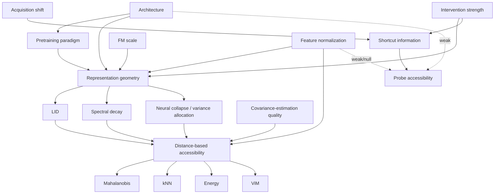

# Causal Graph — Paper 4

No experiments designed here. A DAG for the current hypothesis, built to expose which edges are
actually evidenced vs. assumed, and where conditioning could bias interpretation later.

Two nodes are added beyond the suggested list because the graph is not well-formed without them:
**Intervention strength** (the disentanglement/debiasing objective and its dose, λ_orth in Paper
3) and **Covariance-estimation quality** (sample size / shrinkage — an omitted-variable risk
already flagged in `11_Confound_Map.md`). Both are load-bearing.

---

## Node list

Pretraining paradigm · Foundation model scale · Architecture · Intervention strength ·
Representation geometry (latent construct) · LID · Spectral decay · Neural collapse
(variance allocation) · Feature normalization · Covariance-estimation quality · Shortcut
information (domain leakage) · Acquisition shift · Probe accessibility · Distance-based
accessibility (latent construct) · Mahalanobis · kNN · Energy · ViM

## Edge list

| Edge | Label | Why |
|---|---|---|
| Acquisition shift → Shortcut information | **Observed** | Paper 1 established that ISIC-vs-PAD-UFES acquisition shift is linearly decodable from a baseline classifier's representation (probe accuracy 0.979). |
| Architecture → Pretraining paradigm | **Observed, but confounded in practice** | CNNs in this project line are supervised-trained; candidate FMs are SSL/contrastive-pretrained. These two nodes are not experimentally independent with the currently available options — see Hidden Assumptions Audit (`18_Hidden_Assumptions.md`), assumption 3. |
| Foundation model scale → Representation geometry | **Hypothesized** | Plausible (larger models → different ambient dimensionality/manifold structure) but not directly tested by anything read this session. |
| Pretraining paradigm → Representation geometry | **Hypothesized, partial support** | arXiv:2510.15202 (Level A) shows geometry varies substantially across SSL backbones, implying pretraining choices shape baseline geometry — but that paper doesn't compare SSL vs. supervised pretraining directly. |
| Architecture → Representation geometry | **Hypothesized** | Plausible via inductive bias (conv locality vs. attention) but not isolated from Pretraining paradigm in anything read. |
| Intervention strength → Representation geometry | **Observed** | Paper 3 directly: condition number shifts two orders of magnitude across λ_orth = 0, 1, 5 (Kendall's τ=0.84). |
| Intervention strength → Shortcut information (post-intervention) | **Observed** | Paper 1/3: disentanglement reduces domain-leakage probe accuracy from ~0.98 toward 0.72–0.81, but does not erase it. |
| Feature normalization → Representation geometry | **Observed** | arXiv:2510.15202's own central manipulation: β-scaled ℓ2 normalization directly and provably reshapes radial geometry. |
| Representation geometry → LID | **Observed (operational)** | LID is one of the two measured facets of "geometry" in the primary mechanism source. |
| Representation geometry → Spectral decay | **Observed (operational)** | Same source, second facet. |
| Representation geometry → Neural collapse / variance allocation | **Hypothesized** | Distinct facet proposed via Mechanism B (`08_Mechanism_Map.md`), not measured by the same primary source — Level B/C. |
| LID → Distance-based accessibility | **Observed** | Primary mechanism source: LID × spectral-decay slope predicts Mahalanobis performance directly (their regression, R²=0.25–0.47). |
| Spectral decay → Distance-based accessibility | **Observed** | Same. |
| Neural collapse / variance allocation → Distance-based accessibility | **Hypothesized** | Mechanism B's claim, unread at primary-source level. |
| Covariance-estimation quality → Distance-based accessibility | **Observed (background)** | Standard statistical fact (Mahalanobis requires an invertible, well-estimated Σ); not specific to this project but real. |
| Feature normalization → Distance-based accessibility | **Observed** | Direct manipulation in the primary mechanism source. |
| Feature normalization → Probe accessibility | **Hypothesized (expected weak/near-null)** | Linear probes are largely invariant to monotonic/radial rescaling because they can absorb it into learned weights — this predicted *asymmetry* (normalization strongly moves distance-accessibility, weakly or not at all moves probe-accessibility) is itself a load-bearing, testable part of the hypothesis, not a side note. |
| Shortcut information → Probe accessibility | **Observed** | Definitionally close — Papers 1/3 measure probe accessibility as the operationalization of shortcut information. |
| Distance-based accessibility → Mahalanobis, kNN, Energy, ViM | **Observed (operational)** | These four (and 4 more not listed by the user but present in Paper 3: cosine-to-centroid, KDE, energy again, ViM) are treated as instantiations of one latent "distance/density-based accessibility" construct — Paper 3 found 6/7 converged, supporting this grouping, imperfectly (one, energy, showed an isolated upward trend). |
| Architecture → Probe accessibility | **Hypothesized, weak** | Mechanism Map §5 (arXiv:2310.19041, Level B/C): SSL/FM representations may be inherently more linearly separable — untested here. |

## Mermaid sketch (for visual reference)

---

## Colliders, mediators, confounders

**Mediators (the point of the whole hypothesis):** Representation geometry sits on the only
causal path from {Architecture, Pretraining paradigm, FM scale, Intervention strength, Feature
normalization} to Distance-based accessibility. This is exactly what "geometry mediates
accessibility" asserts structurally, not just narratively — the graph makes it precise: if you
could hold Representation geometry fixed while varying any of its parents, Distance-based
accessibility should not move (this is Prediction 2's logic, restated causally).

**Confounders:**
- **Architecture confounds Pretraining paradigm and Representation geometry.** Because no
  architecture in the current plan varies independently of its pretraining paradigm (CNN =
  supervised, FM = SSL, always bundled), any observed Architecture→Representation-geometry
  relationship cannot be cleanly attributed to architecture *per se* vs. pretraining paradigm.
  This is the graph-formal version of Confound Map item #1/#2.
- **Intervention strength confounds the three geometry facets (LID, spectral decay, neural
  collapse) with each other.** All three are common effects of the same λ_orth; a naive
  correlation between any two of them across the ladder doesn't establish that one causes the
  other — restates Prediction Audit's P1 concern formally.

**Colliders — the important one:** **Representation geometry is a collider between Architecture
and Intervention strength** (both point into it). This matters directly for Prediction 3's test
design: Prediction 3 requires *conditioning on* Representation geometry to ask whether Architecture
still predicts Distance-based accessibility. Conditioning on a collider that is a common effect of
two variables you are trying to relate (here, indirectly, Architecture and Intervention strength,
insofar as both shape geometry) can open a spurious statistical path between them. In practice:
if we condition on geometry and then still find an Architecture effect, we cannot immediately be
sure that effect is a genuine direct path (Architecture → Distance-based accessibility, bypassing
geometry) rather than an artifact of collider-conditioning induced by unmeasured joint causes of
geometry we haven't included in the graph (e.g., dataset-specific quirks, training-recipe
details). This is a real statistical hazard for Prediction 3 specifically, on top of the
range-restriction concern already flagged in `10_Prediction_Audit.md`.

**Variables we should never condition on (without explicit justification):**
- **Distance-based accessibility itself**, when trying to study what causes Representation
  geometry to vary — it is a downstream effect of geometry, not a cause; selecting on it (e.g.,
  "only analyze checkpoints where Mahalanobis succeeded") would bias any upstream inference.
- **Mahalanobis / kNN / Energy / ViM individually**, when trying to make claims about
  "distance-based accessibility" as a category — conditioning analysis on one specific scorer's
  outcome risks conflating idiosyncrasies of that scorer with the general construct (this is
  exactly the concern the Falsification Matrix raises about the energy scorer's isolated
  upward trend in Paper 3).

---

## Backdoor paths that could invalidate causal interpretation

1. **Architecture ← Pretraining paradigm → Representation geometry → Distance-based accessibility.**
   An observed Architecture-to-accessibility association could run entirely through baseline
   pretraining-paradigm differences in geometry that have nothing to do with the intervention
   or with "architecture" as such. Blocking this path requires either controlling for Pretraining
   paradigm directly (hard — no architecture option available varies it independently) or being
   explicit that any Architecture claim is really an Architecture-*and*-Pretraining-paradigm
   claim, not a pure architecture claim.

2. **Acquisition shift → Shortcut information ← [unmeasured dataset confounds: resolution, color
   calibration, lesion-type distribution] → Probe accessibility.** A backdoor from the "true"
   acquisition-shift construct to Probe accessibility that runs through unmeasured, non-acquisition
   confounds baked into the ISIC/PAD-UFES-20 split itself (Confound Map item #10). This path is
   inherited from Papers 1–3 and only partially blocked by their existing shuffle-label sanity
   checks.

3. **Intervention strength → [training dynamics / effective feature scale, unmeasured] →
   Covariance-estimation quality → Distance-based accessibility**, running in parallel to
   **Intervention strength → Representation geometry → Distance-based accessibility.** If
   higher λ_orth incidentally changes the effective scale or conditioning of the covariance
   estimation problem (independent of "true" geometric structure), an observed
   geometry-accessibility correlation across the ladder could be partly explained by this second,
   uncontrolled path rather than by genuine geometric mediation. This directly motivates keeping
   covariance-estimator sensitivity checks (Confound Map item #7) as a mandatory, not optional,
   robustness arm.

4. **Foundation model scale → Representation geometry ← Feature normalization.** If FM scale
   correlates with which normalization convention is used by community default (larger/newer
   models often ship with different standard preprocessing), an apparent "FM scale affects
   geometry" finding could be a normalization-convention artifact in disguise — this backdoor
   is blocked only if normalization is held to an explicit, shared scheme across all FM scales
   tested (Confound Map item #2's control, restated here as a graph-formal necessity).

None of these paths invalidate the hypothesis. They specify exactly what "control for confounds"
has to mean in causal terms before any correlational finding in this project could support a
mediation claim rather than an association claim.
