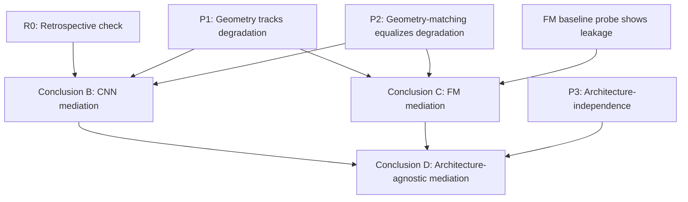

# Dependency Graph — Paper 4

Which predictions/checks depend on which, and what survives if a given one fails. Goal:
robustness, not support.

## Nodes

- **R0 — Retrospective mechanism check.** LID × spectral-decay predicts Mahalanobis degradation
  on Paper 3's existing CNN checkpoints. (Free, Week 0 of `16_Minimal_Sufficient_Experiment.md`.)
- **P1 — Geometry tracks degradation.** Distance-estimator degradation co-varies with LID/
  spectral-decay shifts, not merely with intervention-strength label or probe accuracy.
- **P2 — Geometry-matching equalizes degradation.** Holding geometry constant across different
  intervention strengths (via the normalization knob) holds degradation constant too — the causal,
  not just correlational, version of P1.
- **P3 — Architecture-independence.** Once geometry is known, architecture (CNN vs. FM) adds no
  further predictive power for distance-estimator failure.
- **Conclusion B — Geometry mediates accessibility within the CNN setting.** Requires R0 and P1
  and P2 all holding on CNN data.
- **Conclusion C — Geometry mediates accessibility within the FM setting.** Requires the FM
  baseline probe to show leakage exists (Risk Register #3) and P1 and P2 holding on FM data.
- **Conclusion D — Architecture-agnostic mediation (the strongest, original headline claim).**
  Requires B and C both established, *plus* P3 holding with adequate geometric-range sampling.

## Dependency structure

P1 is the trunk: it feeds both B and C directly, and both B and C are prerequisites for D. P2 is a
parallel strengthening input to both B and C — it upgrades them from "geometry correlates with"
to "geometry causally accounts for," but B and C can survive, weakened, without it. R0 only gates
B (and, indirectly, whether the project proceeds to FM work at all per the Minimal Sufficient
Experiment's staging) — it does not gate C directly, since C could in principle be established by
a self-contained FM result even if the CNN retrospective check fails (see below).

## If X fails, what survives?

**If P1 fails:** Everything downstream fails. B, C, and D all collapse — this is the trunk of the
tree, consistent with `10_Prediction_Audit.md` treating P1 as foundational. The hypothesis as a
geometric-mediation account is falsified outright; the project's fallback is the Falsification
Matrix's alternative hypotheses (`13_Competing_Hypotheses.md`), not a weakened version of this one.

**If P2 fails but P1 holds:** B and C survive in a **weakened form** — "geometry correlates with
accessibility" survives; "geometry causally mediates accessibility" does not, since P2 was the
test that distinguished mediation from mere co-occurrence (per the common-cause alternative
explanation flagged for P1 itself in `10_Prediction_Audit.md`). This is still a publishable
correlational finding, matching the "if contradicted" branch already anticipated in
`Scientific_Hypothesis.md`. D becomes moot — a causal architecture-agnostic claim can't be
built on a merely correlational base for B and C.

**If P3 fails but P1 and P2 hold:** B and C survive **fully intact** — geometry mediates
accessibility within each architecture studied, separately. Only D fails. This is the scenario
`21_Prediction3_Removed_Reevaluation.md` argues is likely and argues is *fine* — the paper's
contribution downgrades from "one universal law" to "the same mechanism, independently confirmed
twice," which is a smaller but more defensible claim.

**If R0 fails (retrospective check doesn't hold on Paper 3's own CNN data), but a *new*,
independent FM test of P1/P2 succeeds:** This is the one genuinely asymmetric case in the graph.
B fails (we cannot explain Paper 3's original CNN result this way after all — a real blow to the
mechanism's connection to this project's own prior work). But **C can still survive independently**,
because C's requirements (P1, P2 holding *on FM data*) don't logically require R0 to have
succeeded first — R0 failing only tells us the CNN case has a different (or unexplained)
mechanism, not that the FM case must fail too. In this scenario the paper's framing would have to
change substantially: it stops being "we explain Paper 3" and becomes "we report a new
geometry-accessibility finding in foundation models, and separately note that Paper 3's original
CNN result remains mechanistically unexplained by this account" — a legitimate but different
paper, and a real risk worth carrying (this is Risk Register item #6's scenario, now made
graph-explicit).

**If the FM baseline probe shows no leakage (no shortcut present pre-intervention):** C fails
directly (nothing for the intervention to act on), independent of P1/P2/R0. B is unaffected. D
fails (needs C). This is Risk Register item #3, now placed in the dependency structure rather than
listed standalone.

## Reading this graph for robustness

The most load-bearing single node is **P1** — it is upstream of every other conclusion. The
**cheapest node to check first is R0** (free, Week 0) and it gates the highest-cost part of the
plan (Weeks 2–4 of `16_Minimal_Sufficient_Experiment.md`), which is exactly why it's staged first
regardless of which conclusion is being pursued. **D is the only conclusion requiring all of
P1, P2, P3, B, and C simultaneously** — it is the most fragile node in the entire graph by
construction, having four independent points of failure feeding into it (any one of P1, P2, P3,
or the FM-baseline-leakage check failing kills D), while B and C each have only two or three.
This asymmetry is the graph-formal version of why `21_Prediction3_Removed_Reevaluation.md`
concludes that dropping the requirement for D sharpens, rather than weakens, the project's
robustness.
